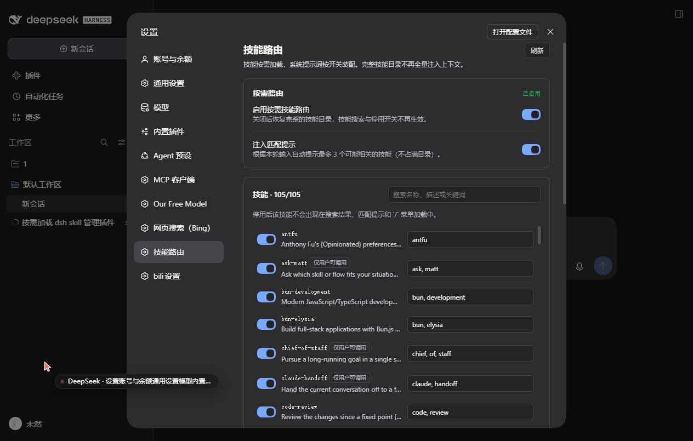

# dsh-skill-router · 技能路由器

按需加载 DSH 技能，并管理本会话的系统提示词装配。

## 为什么

默认的 `dsh-tool-skill` 会在每一轮把**完整技能目录**塞进会话上下文（本机 100+ 个技能，每轮数千 token）。
本插件把目录换成按关键词检索：

- 模型需要技能时调用 `skill_search`（关键词 → 精确技能名），再调用原有的 `skill` 工具加载全文；
- 每轮自动注入的完整目录被移除，只保留一段约 600 字符（≈150 token）的「按需检索」说明；
- 命中关键词时额外注入一条最多 3 个技能的小提示（可关）；
- 被停用的技能由 tool guard 直接拒绝加载；
- 系统提示词段落可以逐段开关，并可追加一段自定义指令。

## 启用

```text
plugin_manager install_bundle  target = <本目录绝对路径>
```

安装后随 profile 生效（HMR 即时挂载），重启后保留。
插件启动时会自动让客户端模块重新组合（`rescan_ui`），设置页通常刷新一次浏览器即可出现；若仍未出现，重启应用一次。

## 设置页

「设置 → 技能路由」提供：

- 按需路由总开关、匹配提示开关；
- 技能列表：搜索、逐个启用/停用、关键词行内编辑（留空恢复自动推导）；
- 系统提示词段落的启用/停用，以及追加提示词（textarea + 保存）。



设置页通过同源接口读写，不依赖 RPC：

| 方法 | 路径 | 说明 |
|---|---|---|
| `GET` | `/api/skill-router/state` | 返回完整状态（技能、提示词段、UI 组合状态） |
| `POST` | `/api/skill-router/action` | `{action, ...}`，支持 `set_active` / `set_hints` / `toggle_skill` / `set_keywords` / `set_prompt_active` / `toggle_section` / `set_extra` / `refresh` / `rescan_ui` |

`rescan_ui` 会清除 client-modules 对“非客户端包”的缓存并重新组合，可让新增的 `client.js` 无需重启即可进入模块图。

## 状态文件

`<DSH_HOME>/skill-router/state.json`（默认 `C:\Users\<你>\.dsh\skill-router\state.json`），可手工编辑，也由工具/设置页自动写入。

```json
{
  "version": 1,
  "active": true,
  "injectHints": true,
  "skills": {
    "office-pptx": { "enabled": false, "keywords": ["ppt", "幻灯片", "演示文稿"] }
  },
  "prompt": {
    "active": true,
    "disabledSections": [],
    "extra": "始终用简体中文回答。"
  }
}
```

- `active`: 总开关。关闭后恢复默认的完整技能目录。
- `injectHints`: 是否注入关键词命中提示。
- `skills.<name>.enabled`: `false` 表示停用。
- `skills.<name>.keywords`: 该技能的路由关键词；为空时自动从名字/`whenToUse` 推导。
- `prompt.disabledSections`: 要隐藏的系统提示词段落名（用 `skill_manager` 的 `prompt` 动作查看名字）。
- `prompt.extra`: 追加到系统提示词末尾的自定义文本。

## 给模型的工具

| 工具 | 作用 |
|---|---|
| `skill_search` | 关键词检索已启用技能，返回精确名字、描述、命中分数 |
| `skill_manager` | `list` / `toggle` / `keywords` / `prompt` / `prompt_toggle` / `prompt_extra` / `state` / `reload` |

示例：

```text
skill_search(query: "把文档转成 PPT")
skill_manager(action: "toggle", skill: "office-pptx", enabled: false)
skill_manager(action: "keywords", skill: "office-pptx", keywords: "ppt,幻灯片,演示文稿")
skill_manager(action: "prompt_extra", extra: "回答尽量简短。")
```

## 边界

- 已在进行中的会话如果之前已经注入过完整目录，旧消息无法删除；新会话开始即按需模式。
- 关掉 `active` 或卸载插件后，`dsh-tool-skill` 的原始行为立即恢复。
- 系统提示词段落只能「隐藏」或追加文本；`complete` 段落在装配后会被框架恢复，无法被隐藏。
- 客户端设置页若未出现：刷新页面；仍不出现则重启应用一次（并可用 `POST {action:"rescan_ui"}` 检查组合状态）。
